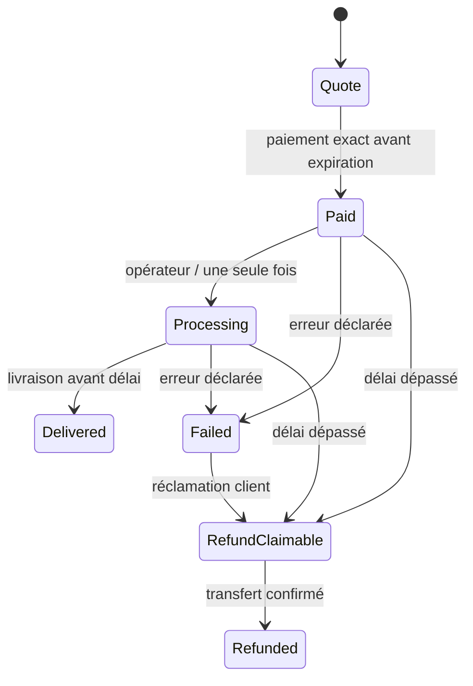

# Missions d’analyse payées

Brief du 3 novembre 2026. Réutiliser le catalogue contractuel, les wallets sans clé, les montants entiers, le mandat de souscription unique, la validation ML-DSA dans les contrats, le séquestre demoUSD et le mint après crédit. Préserver les sessions et positions existantes. Aucun AGENTS.md supplémentaire trouvé dans le dépôt ou ses parents.

Composants réutilisés : factory de wallets sans clé, signature ML-DSA-65 dans le host NEAR, mandat `AuthorizeSubscription`, séquestre demoUSD `AgentSubscribe`, `agent_subscribe` et NFT après financement/indexation. Les formats et états des contrats wallet/collection existants ne sont pas changés par cette extension. Ajouts : `contracts/missions`, moteur `packages/agent/missions.ts`, worker et service `scripts/missions-*`, `src/AgentMissions.tsx`. Le profil gratuit des anciennes sessions reste uniquement dans leur parcours historique.

## Prix et devis

Trois profils configurés à l’initialisation : `tradfi` 0,015 NEAR, `crypto` 0,02 NEAR, `liquidity` 0,01 NEAR. Valeurs de démonstration modifiables par variables serveur avant déploiement ; ensuite `set_profile` exige l’opérateur et une version strictement supérieure. Chaque devis conserve son profil, sa version, son prix et son délai. Un changement du catalogue ne reprécifie pas un devis existant.

Le devis nécessite **0,05 NEAR de réserve de stockage non remboursable**, séparés de l’analyse et indiqués avant la transaction. Le prix d’analyse est versé exactement dans `pay` par le commanditaire enregistré ; il n’existe ni commission de performance ni abonnement. Le gas s’ajoute aux transactions. Une nouvelle position provisionne séparément **6 NEAR** auprès de la factory et **0,02 NEAR** auprès de la stratégie ; ces montants techniques ne sont pas du capital investi. Tous ces NEAR sont des unités de sandbox.

Identifiant unique de 16–64 caractères, engagement de demande de 32 octets et devis valable au plus 600 secondes. Le délai de traitement, figé dans le devis, démarre au paiement ; 120 secondes dans la configuration de démonstration. Le contrat borne le délai à 5–3600 secondes. Proposition valable 15 minutes par défaut, au plus 24 heures sur chaîne. Bornes MVP : quatre collections, quatre allocations par mission, 1 000 missions dans le contrat, 100 missions dans la vue historique bornée.

## Machine à états

À l’expiration exacte, la livraison est interdite (`now < deadline`) et la réclamation est autorisée (`now >= deadline`). Une livraison enregistrée exclut définitivement le remboursement de cette analyse. Une réclamation interdit toute livraison tardive. L’abstention est une livraison conforme, donc rémunérée ; elle ne permet pas d’investir.

Le frais de mission NEAR rémunère une livraison d’analyse. Il ne dépose aucun demoUSD et ne confère aucun mandat d’investissement. Devis et livraison publient des empreintes ; la demande et le livrable restent hors chaîne. Le paiement prestataire exige une livraison enregistrée avant le délai ; cela ne prouve pas la qualité financière du conseil. Livraison et remboursement choisissent des branches terminales exclusives. Les versements utilisent une créance fixe, réservée avant promesse et une tentative de callback privée.

Pour investir, le propriétaire signe le mandat existant du wallet avec le contrat de missions comme agent désigné, puis une autorisation ML-DSA propre à la mission. Cette seconde enveloppe lie explicitement mission, proposition, indice d’allocation, réseau, contrats, actif, montant, version, nonce et générations. Le contrat relit le wallet et vérifie cette signature avant d’exécuter via la collection. Le worker ne possède aucune clé de propriétaire. Une allocation conserve le même compte lors des reprises ; une opération confirmée n’est pas rejouée.

Les deux créances natives suivent `Claimable → Paying → Paid`. Leur bénéficiaire et montant sont fixes. La tentative est réservée avant la promesse ; seul le callback privé correspondant peut la résoudre. Un échec de transfert connu réouvre `Claimable`. Une réponse absente ou inconnue conserve `Paying` : aucune nouvelle sortie de fonds automatique. Les réconciliations d’un transfert natif inconnu ne sont pas implémentées dans ce MVP ; il nécessite une inspection des reçus. Le contrat n’a aucune méthode générique de retrait. La réserve de stockage reste dans le contrat sans mécanisme administratif de récupération.

## Catalogue de demonstration

La démo interactive lit la seule collection déployée et ses règles immuables ; aucune route partenaire ou offre d’actions/ETF n’est ajoutée. Les preuves isolées déploient deux véritables collections et deux contrats de stratégie distincts pour éprouver les opérations multiples. Ce second catalogue de test n’est pas injecté dans la marketplace interactive.

`CatalogueEntry` est construit par le service à partir de `series`, de la capacité déjà engagée et d’une configuration locale de risques : demoUSD de test, stratégie préfinancée sans audit indépendant, absence de bridge, sortie à l’échéance. Les sources portent leur date et leur version. Il n’y a ni cours externe ni mesure de risque de marché ni rendement prédit. Les faits documentaires locaux sont une hypothèse de confiance du service, pas une attestation obtenue sur chaîne.

| Profil | Critère effectif | Abstention ou limite |
| --- | --- | --- |
| TradFi | Mesure les parts des actifs déjà détenus et priorise les stratégies les moins exposées ; au plus 50 % du budget par contrat de stratégie, même s’il apparaît dans plusieurs collections. | Un seul actif ne diversifie pas les actifs. Les expositions communes non documentées ne sont pas inférées. TradFi décrit une méthode, pas un accès à la finance traditionnelle. |
| Crypto | Exige des risques et une référence documentaire pour chaque route ; contrôle adresses/versions et conserve au moins 20 % du budget. | Route non documentée écartée ; aucune voie sans risque de protocole promise. |
| Liquidité | Trie par échéance et conserve au moins 30 % du budget ; vérifie horizon, fenêtre et minimum de souscription. | Disponibilité immédiate incompatible avec les positions verrouillées : tout reste disponible, abstention. Une annonce de revente ne garantit pas une sortie. |

Tous respectent actif, exclusions, capacité, besoin de disponibilité et risque à éviter. Une demande « aucune perte » entraîne une abstention, sans transformer le souhait en garantie. Les notes sont des données non fiables, jamais une source d’outils ou de permissions.

## Schémas et validation

Les types `MissionRequest`, `Allocation`, `Proposal`, `AnalysisInput` et leurs validateurs sont dans `packages/agent/missions.ts` ; les vues du contrat et documents sont dans `packages/shared/missions.ts`. Les champs autorisés sont vérifiés strictement. Budget en demoUSD avec six décimales à l’entrée, puis entiers décimaux u128 ; aucune conversion en flottant pour une dépense. `allocations + reserve = budget` exactement.

Proposition : mission/profil/version/mode/engagement, création/expiration, routes et versions, montants, réserve, raisons, risques, sorties, opérations nécessaires et sources datées. Les adresses, paramètres, minimums, capacité, exclusions, concentration et liquidité sont revérifiés indépendamment du worker. La lecture contractuelle du catalogue doit dater de moins d’une minute ; la source initiale d’une proposition reste bornée à 15 minutes. Les routes et leur capacité sont relues immédiatement avant consentement, dépôt et exécution ; les montants déjà réservés par cette même mission sont comptés pour éviter un faux dépassement de capacité lors d’une reprise.

## Autorisation d’investissement

1. Examiner la proposition livrée et choisir Préparer l’investissement ; aucune dépense à cette étape.
2. Pour chaque allocation, le contrat de missions lie définitivement son indice au même compte enfant de la collection autorisée. Le service crée ce compte et conserve la clé ML-DSA locale en mémoire. En cas de reçu de création incertain, la clé est conservée et une reprise relit ce même compte sans renvoyer une seconde provision de 6 NEAR.
3. Le propriétaire signe le mandat existant `AuthorizeSubscription`, avec le contrat keyless de missions comme agent, le montant exact et une échéance limitée.
4. Il signe également l’enveloppe canonique `EVERKEEP_MISSION_INVEST_V1`. Le contrat de missions relit le wallet et vérifie la signature ML-DSA réelle, sa clé, propriétaire, nonce, générations, réseau, règles de série et mandat exacts. Le nonce est celui du wallet après le mandat ; la machine à états de l’allocation empêche le rejeu du consentement accepté. L’expiration signée est conservée et recontrôlée à l’exécution.
5. Le propriétaire verse le demoUSD exact via le séquestre existant. Le worker ne peut pas effectuer ce dépôt à sa place.
6. L’opérateur appelle le contrat de missions ; celui-ci est le seul agent autorisé à appeler `collection.agent_subscribe` pour ce mandat. Le worker ne peut pas le contourner depuis son propre compte.
7. Le contrat confirme l’opération seulement après relecture du wallet financé et du NFT indexé au commanditaire. Plusieurs souscriptions ne sont pas atomiques.

Enveloppe, dans l’ordre de sérialisation : `protocol, version, network, verifier, mission_id, proposal_hash, request_hash, owner, allocation_index, position, allocation, ownership_epoch, key_version, policy_version, nonce, expires_at`. L’allocation canonique contient `collection, strategy_id, strategy_version, asset, strategy, amount, mandate_hash`. U64/u128 sont des chaînes décimales, empreintes et signatures du Base64. Tout changement d’ordre, champ inconnu ou paramètre différent est rejeté.

Engagement d’allocation : SHA-256 de la sérialisation JSON du tuple `['EVERKEEP_ALLOCATION_V1', network, missions_contract, mission_id, client, result_hash_base64, index_as_string, canonical_allocation]`. Le contrat Rust utilise un tuple typé et une structure à ordre explicite, indépendants de l’ordre des dictionnaires JSON. Les engagements de proposition et de demande utilisent des objets JSON aux clés triées (`stableJSON`). Demande : `['EVERKEEP_PRIVATE_REQUEST_V1', random_salt, request]`.

Chaque opération suit `Reserved → Verifying → Authorized → Funding → Confirmed`, avec `Rejected` pour un consentement invalide et `Uncertain` pour un résultat non confirmé. Une réconciliation relit les contrats sans dépense. La reprise d’un état incertain exige la souscription durable `Authorized` dans la collection, le même compte/montant/propriétaire, et les expirations toujours valides. La collection est la barrière de consommation unique, réservée avant sa promesse. Une opération déjà confirmée ne retourne jamais à un état exécutable. Révocation et remboursement d’un dépôt passent par les méthodes signées existantes ; une souscription en cours de financement ne devient pas remboursable en parallèle.

ML-DSA protège l’autorisation sensible, pas la qualité de l’analyse ni la sécurité des placements. Les transactions de transport NEAR utilisent toujours le chemin classique du sandbox ; aucune résistance post-quantique de bout en bout n’est revendiquée.

## Worker, adaptateur et confidentialité

Le moteur est une interface pure sans réseau ni signature. Le service lance un processus enfant avec uniquement `AnalysisInput` sur stdin et une petite liste de variables d’environnement ; il ne transmet ni clé propriétaire, ni objet signer, ni accès à une commande de transaction. Sortie JSON limitée à 64 Kio, entrée à 64 Kio et délai de processus de 12 secondes. Les erreurs du prestataire, susceptibles de contenir la demande, ne sont pas journalisées.

Sans `EVERKEEP_ANALYSIS_ENDPOINT`, le résultat porte `mode: demonstration` et aucun appel IA n’est effectué. L’adaptateur facultatif envoie `{input, instruction}` à une URL **HTTPS configurée par le serveur**, sans redirection ni outils, timeout HTTP 8 secondes, réponse `Proposal` avec `mode: server-adapter`, validation complète. `EVERKEEP_ANALYSIS_KEY` reste serveur. Il s’agit d’un protocole JSON d’adaptateur, pas d’une intégration directe revendiquée avec un fournisseur commercial. Son texte financier libre n’est pas publié : explications, faits et risques proviennent des méthodes/documentation locales, après contrôle des choix numériques. Aucun fournisseur distant n’a été configuré ou testé dans cette livraison.

Le navigateur produit une capacité aléatoire de 256 bits et la conserve dans localStorage, séparée par API et compte. Elle est transmise dans les corps POST, jamais dans une URL. La lecture/run/préparation de documents exige son empreinte et le commanditaire attendu. Les documents sont chiffrés AES-256-GCM dans un répertoire temporaire hors dépôt, avec clé dérivée de la capacité et de l’identifiant, nonce aléatoire et identité liée par AAD. Le serveur conserve l’empreinte de capacité, pas sa valeur en clair entre requêtes. Sel cryptographique et contenu complet ne sont pas publiés sur chaîne. Les réponses sont `no-store` ; origines et taille de requêtes sont limitées, API sur loopback.

**Limites de confiance de la démonstration :** le service API est aussi le signataire local Alice/Bob, les clés restent en mémoire dans son processus. Le choix de personnage n’est pas une authentification distante ; un utilisateur ou programme malveillant du même système peut forger l’origine HTTP. Le processus enfant est une séparation de code/données, **pas un sandbox OS face à un exécutable malveillant**. L’opérateur et la machine locale sont donc de confiance. Une XSS dans l’origine peut voler une capacité ; elle est un secret porteur, pas une preuve de possession du wallet. L’adaptateur configuré reçoit le texte privé. Le chiffrement ne protège pas d’un serveur actif compromis ayant accès à la requête et sa capacité.

L’arrêt du service perd les clés de positions, les index d’accès aux documents, les commandes en mémoire et la continuité de cette sandbox. Les fichiers chiffrés seuls ne constituent pas une restauration complète. Ne pas relancer une session contenant des positions pour la rafraîchir. Une capacité perdue rend le document indisponible ; les états publics et les possibilités contractuelles de remboursement restent lisibles. À préparer avant usage distant : coffre de clés/reprise durable, authentification wallet, capacité récupérable, stockage de tâches transactionnel et isolation OS du worker. Rien de cela n’est présenté comme livré.

## Vérification et reprise

`npm run test:missions` utilise les vrais WASM : paiement exact/tiers/rejeu, permission absente après paiement, traitement unique, livraison non autorisée, confidentialité, branche livraison/remboursement, signatures ML-DSA altérées et rejouées, deux souscriptions dont une échoue puis reprend, retrait worker refusé, délai, devis expiré, transfert prestataire échoué puis réclamé une seule fois. Résultat daté dans `docs/results/agent-missions.json`. Les contrôles indépendants de proposition dans `tests/missions.test.ts` ajoutent injection, routes inventées, budget, exclusions, version/capacité et expiration.

`npm run test:missions:browser` réalise le scénario Alice sur Chrome desktop/mobile, avec vrais frais NEAR, vrais demoUSD et NFT, mission échouée/remboursée et abstention. Les captures et contrôles figurent dans `docs/results/agent-missions-ui.json`. Les anciens parcours restent vérifiables sur `?session=orbite` ; leurs preuves ne sont pas assimilées à une mission payée. Aucun déploiement externe, argent réel ou audit de sécurité n’est revendiqué.
