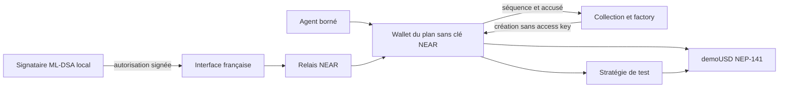
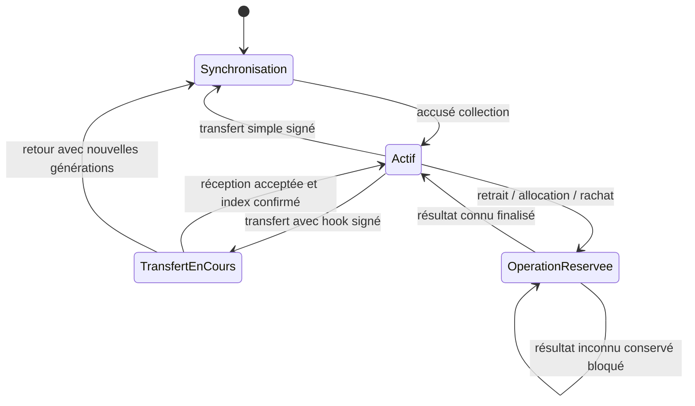

# Architecture et états

## Composants

| Composant | Responsabilité |
|---|---|
| `wallet` | Autorité ML-DSA-65, comptabilité, mandat borné, rotations, transferts et réservations |
| `collection` | Factory de comptes nommés sans clé et index NFT ; métadonnées, énumération et synchronisation |
| `demo-token` | NEP-141/145 via near-contract-standards, demoUSD à six décimales, offre fixe |
| `strategy` | Route fixe de test : position par wallet, réserve de rendement et rachat |
| `test-receiver` | Contrat adversarial de test uniquement : tentative de retrait pendant un transfert temporaire |
| Agent | Interprétation déterministe d’une intention française et proposition ; aucun secret propriétaire |
| Interface | Lecture wallet/collection au même bloc final, montants BigInt, séparation objectif/rendement observé |

La factory déploie le WASM du wallet embarqué dans son propre binaire. Les plans sont des sous-comptes immédiats de la collection. Le wallet vérifie son namespace et l’appel d’initialisation. Le coût minimum de création est de 6 NEAR de test, dont 0,05 conservé par la factory comme financement technique. Ce financement n’entre pas dans le capital demoUSD.

Les comptes nommés rendent le namespace et le lien factory/wallet directement vérifiables. Les comptes déterministes de NEP-616 sont une autre approche de création, mais n’apportent pas la preuve de propriété, le protocole de transmission ou les règles de signature : ils ne sont pas nécessaires au MVP. Un wallet par plan isole les soldes ; le coût de code dupliqué est accepté plutôt que d’ajouter une infrastructure de code partagé.

## Autorité et lecture

Le wallet porte le propriétaire et les générations. La collection est un index, jamais une source autonome d’autorisation financière. Le client lit les deux états au même hash de bloc final et compare namespace, identifiants, propriétaire, epoch et séquence. Il refuse une paire incohérente ou un wallet inactif. Ce contrôle personnalisé n’implémente pas le brouillon Sharded NFT Items.

La politique lie l’agent, le FT, la stratégie, les plafonds, l’expiration et les générations. L’interprétation du français ne remplace pas ces vérifications. `packages/shared/strategy.ts` décrit une frontière d’adaptateur future ; aucune nouvelle route on-chain n’est autorisée par cette interface.

## États financiers

Les montants sont des u128 décimaux, six décimales pour demoUSD. Avant tout transfert externe, le wallet retire le montant du disponible ou du principal et le place en réserve, avec un identifiant et une génération. Les callbacks sont privés ; un résultat obsolète ou doublé n’est pas appliqué deux fois.

- Retrait : disponible → réservé → transfert FT confirmé ; échec connu → disponible.
- Allocation : disponible → réservé → principal pour la seule fraction effectivement consommée ; le remboursement connu revient au disponible.
- Rachat : principal → réservé → disponible après le transfert réel de la stratégie ; échec connu → principal.
- Résultat ambigu d’un resolver : réserve conservée et nouvelles opérations bloquées. Aucun remboursement spéculatif.

L’invariant comptable est `disponible + réservé + principal = dépôts + gains réalisés − retraits`. Un transfert NFT ne déplace pas les actifs et ne remet pas les compteurs à zéro. Les dépôts valides passent exclusivement par le callback du FT configuré ; un transfert FT direct n’est pas comptabilisé.

## États de propriété

Un transfert renouvelle propriétaire, clé, epoch, version de clé et version de mandat, supprime l’agent, puis gèle le compte jusqu’à l’accusé de synchronisation de la collection. La reprise `sync` ne modifie pas l’autorité. Avec receiver, le gel reste actif pendant le hook et son resolver. Le rejet restaure l’ancien propriétaire avec de nouvelles générations, puis attend la synchronisation de retour. Voir le [protocole complet](transfer-protocol.md).

## Environnements

La sandbox utilise les vrais reçus NEAR, signatures et transferts FT ; les clés de personnages de test sont éphémères en mémoire dans une API loopback. Sur testnet, Wallet Selector assure le relais et un outil local chiffré signe ML-DSA. Aucun secret privé n’est envoyé au frontend. Aucun contrat n’a été déployé sur testnet dans cette session.
