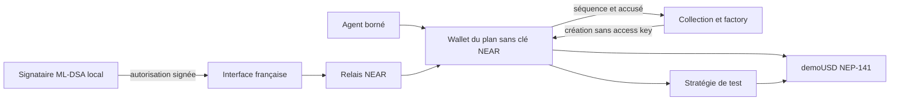
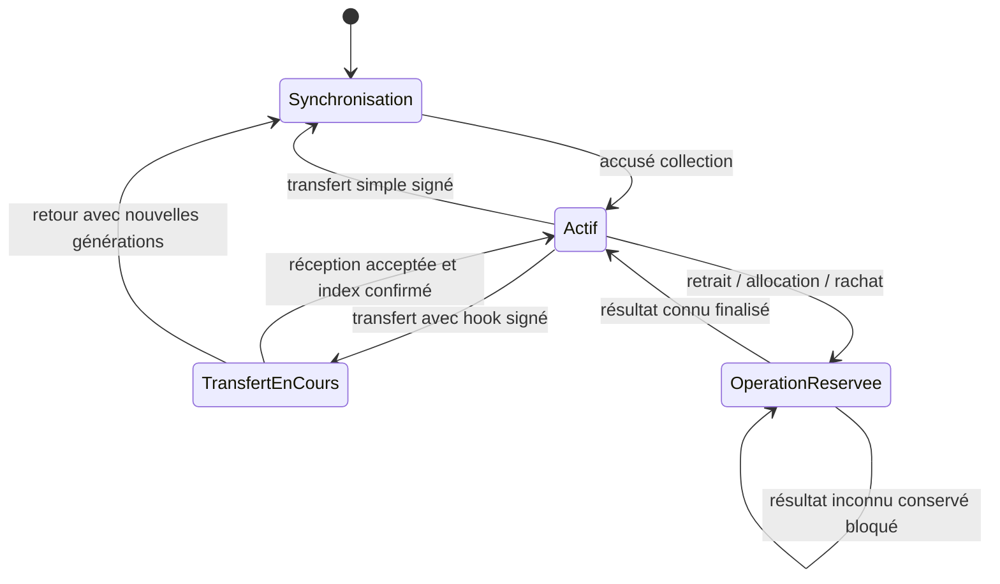

> Parcours courant (4 novembre 2026) : [Agents, deux validations financières](agent-ux-simple.md). Avec l’accord explicite de l’utilisateur, les clés ML-DSA et capacités sont désormais conservées uniquement sous forme chiffrée dans un coffre IndexedDB local ; le mot de passe et les clés déchiffrées restent en mémoire. Export externe facultatif. Devis/paiement combinés puis création groupée dans Intear ; résultats finaux vérifiés et inconnus non rejoués. Les passages historiques ci-dessous décrivent les étapes antérieures. Contrats inchangés dans cette tranche.

> État du 4 novembre 2026 : le mode par défaut est testnet réel. NEAR Connect transporte les signatures du wallet ; le signataire ML-DSA chiffré est dans le navigateur, le worker local ne reçoit aucune clé propriétaire. Trois catégories et trois modèles, dont Liquidité actif en démonstration. Voir [parcours, déploiements et preuves](testnet.md). Les mentions ci-dessous de testnet désactivé et d’API 8791 décrivent des étapes historiques ; la sandbox payante est 8792, l’opérateur testnet est 8793.

> Architecture courante : [marketplace de positions](marketplace-mvp.md) et [missions d’analyse payées](agent-missions.md). Catalogue et annonces sont distincts ; les positions et contraintes existantes ne sont pas migrées. Le nouveau contrat keyless `missions` sépare le paiement natif NEAR de l’analyse et le consentement ML-DSA à la souscription. Le worker reçoit des données, jamais de clés ; un mandat du wallet désigne le contrat de missions, puis une seconde signature lie proposition, mission, route et montant. Documents chiffrés hors chaîne sous capacité ; états et engagements publics. Le serveur local Alice/Bob reste un composant de confiance de démonstration.

## Évolution Explorer / Mes positions / Agent

La navigation est désormais Explorer (stratégies et revente), Mes positions et Agent. Les échéances contractuelles sont conservées. `wallet/src/funding.rs` et `collection/src/agent_funding.rs` ajoutent un mandat de souscription exact, distinct de la politique d’allocation. La proposition pure n’a ni clés ni droit de dépense ; la signature ML-DSA, le séquestre propriétaire et l’exécution par l’agent sont trois opérations séparées. Voir [protocole et preuves](explorer-agent.md).

L’API actuelle utilise8791 ; les sources précédentes8790/8789/8788 restent distinctes si actives. Le mode d’affichage NFT historique ne relâche pas les vérifications financières. Les paragraphes d’interface suivants sont historiques et ne décrivent pas la nouvelle navigation.

## Architecture des séries (option 2)

La collection regroupe désormais index NFT, série unique et séquestre de vente. `contracts/collection/src/series.rs` impose capacité, minimum et fenêtre, réserve le capital avant financement et crée des créances fixes pour échecs connus. La préparation technique ne mint pas : le wallet reçoit ses demoUSD puis synchronise le NFT. Un compte non initialisé/enregistré/synchronisé ne peut pas accepter de souscription.

`contracts/wallet/src/series_types.rs` définit les termes partagés immuables. Chaque wallet en conserve une copie et l’empreinte. `SetPolicy` n’autorise que des droits inférieurs ou égaux aux limites de série, avec expiration avant l’échéance. `Withdraw` exige échéance atteinte, principal et réserves nuls, bénéficiaire propriétaire courant. `Redeem` ne verse pas au propriétaire avant échéance. Le transfert change le contrôle sans remplacer ces termes.

`wallet/src/sale.rs` et `collection/src/market.rs` réalisent le règlement décrit dans settlement.md. Les états en chaînes sont persistants, les callbacks privés et les paiements réservés avant promesse. Un résultat inconnu conserve le verrou. Le séquestre du prix n’entre jamais dans les actifs comptabilisés du wallet.

L’interface `SeriesApp.tsx` contient exactement trois routes. `series-api.ts` n’agit que dans sa sandbox locale avec des personnages de test et garde des identifiants idempotents pour ses commandes. Le wallet externe est un lecteur testnet ; aucune opération financière testnet n’est activée ici. La capacité, les dates et les restrictions restent imposées par les contrats, indépendamment des boutons.

Le format d’état a changé : nouvelles instances obligatoires. La factory historique sans admin conserve ses tests de plans libres ; elle ne représente pas une série. Aucun upgrade ni sweep n’a été ajouté.

Les sections historiques ci-dessous détaillent le socle réutilisé ; leurs mentions de plans libres ou d’objectif/projection ne définissent plus le produit de séries.

# Architecture et états

## Composants

| Composant | Responsabilité |
|---|---|
| `wallet` | Autorité ML-DSA-65, comptabilité, mandat borné, rotations, transferts et réservations |
| `collection` | Factory de comptes nommés sans clé et index NFT ; métadonnées, énumération et synchronisation |
| `demo-token` | NEP-141/145 via near-contract-standards, demoUSD à six décimales, offre fixe |
| `strategy` | Route fixe de test : position par wallet, réserve de rendement et rachat |
| `test-receiver` | Contrat adversarial de test uniquement : tentative de retrait pendant un transfert temporaire |
| Agent | Interprétation déterministe d’une intention française et proposition ; aucun secret propriétaire |
| Interface | Lecture wallet/collection au même bloc final, montants BigInt, séparation objectif/rendement observé |

La factory déploie le WASM du wallet embarqué dans son propre binaire. Les plans sont des sous-comptes immédiats de la collection. Le wallet vérifie son namespace et l’appel d’initialisation. Le coût minimum de création est de 6 NEAR de test, dont 0,05 conservé par la factory comme financement technique. Ce financement n’entre pas dans le capital demoUSD.

Les comptes nommés rendent le namespace et le lien factory/wallet directement vérifiables. Les comptes déterministes de NEP-616 sont une autre approche de création, mais n’apportent pas la preuve de propriété, le protocole de transmission ou les règles de signature : ils ne sont pas nécessaires au MVP. Un wallet par plan isole les soldes ; le coût de code dupliqué est accepté plutôt que d’ajouter une infrastructure de code partagé.

## Autorité et lecture

Le wallet porte le propriétaire et les générations. La collection est un index, jamais une source autonome d’autorisation financière. Le client lit les deux états au même hash de bloc final et compare namespace, identifiants, propriétaire, epoch et séquence. Il refuse une paire incohérente ou un wallet inactif. Ce contrôle personnalisé n’implémente pas le brouillon Sharded NFT Items.

La politique lie l’agent, le FT, la stratégie, les plafonds, l’expiration et les générations. L’interprétation du français ne remplace pas ces vérifications. `packages/shared/strategy.ts` décrit une frontière d’adaptateur future ; aucune nouvelle route on-chain n’est autorisée par cette interface.

## États financiers

Les montants sont des u128 décimaux, six décimales pour demoUSD. Avant tout transfert externe, le wallet retire le montant du disponible ou du principal et le place en réserve, avec un identifiant et une génération. Les callbacks sont privés ; un résultat obsolète ou doublé n’est pas appliqué deux fois.

- Retrait : disponible → réservé → transfert FT confirmé ; échec connu → disponible.
- Allocation : disponible → réservé → principal pour la seule fraction effectivement consommée ; le remboursement connu revient au disponible.
- Rachat : principal → réservé → disponible après le transfert réel de la stratégie ; échec connu → principal.
- Résultat ambigu d’un resolver : réserve conservée et nouvelles opérations bloquées. Aucun remboursement spéculatif.

L’invariant comptable est `disponible + réservé + principal = dépôts + gains réalisés − retraits`. Un transfert NFT ne déplace pas les actifs et ne remet pas les compteurs à zéro. Les dépôts valides passent exclusivement par le callback du FT configuré ; un transfert FT direct n’est pas comptabilisé.

## États de propriété

Un transfert renouvelle propriétaire, clé, epoch, version de clé et version de mandat, supprime l’agent, puis gèle le compte jusqu’à l’accusé de synchronisation de la collection. La reprise `sync` ne modifie pas l’autorité. Avec receiver, le gel reste actif pendant le hook et son resolver. Le rejet restaure l’ancien propriétaire avec de nouvelles générations, puis attend la synchronisation de retour. Voir le [protocole complet](transfer-protocol.md).

## Environnements

La sandbox utilise les vrais reçus NEAR, signatures et transferts FT ; les clés de personnages de test sont éphémères en mémoire dans une API loopback. Sur testnet, Wallet Selector assure le relais et un outil local chiffré signe ML-DSA. Aucun secret privé n’est envoyé au frontend. Aucun contrat n’a été déployé sur testnet dans cette session.
